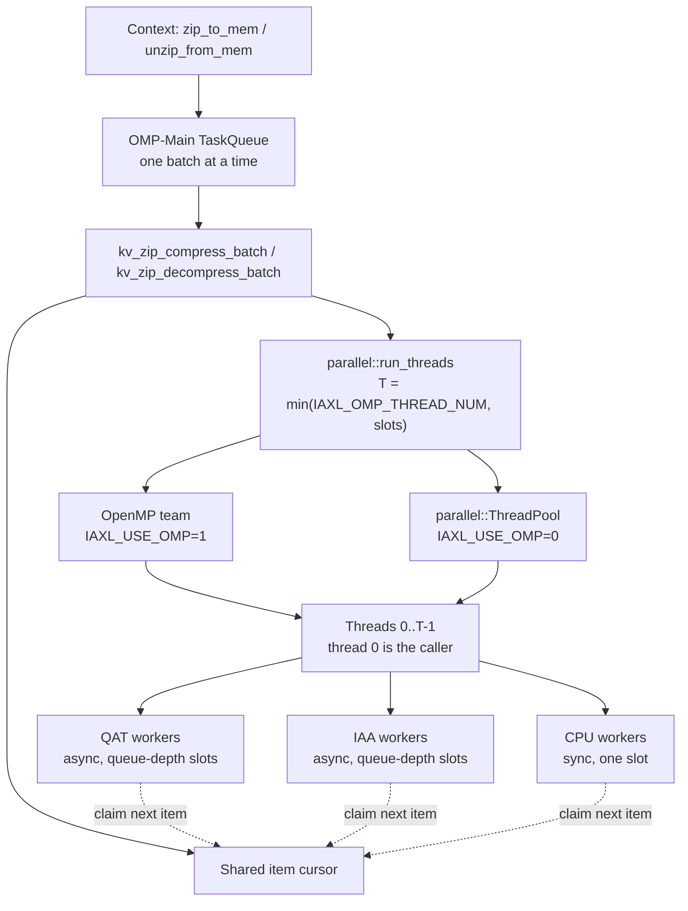
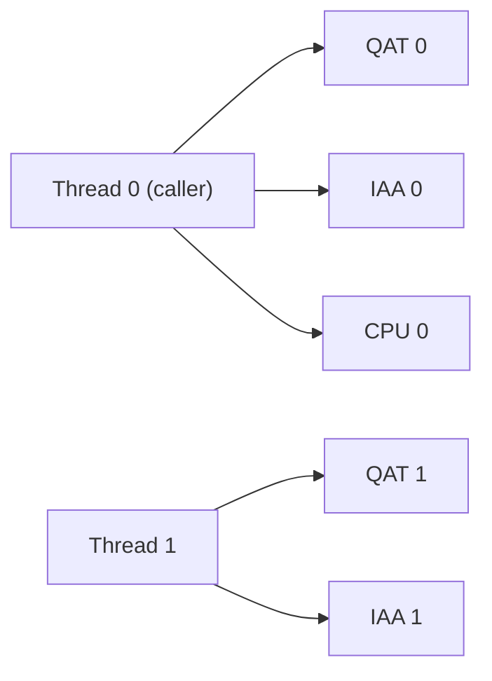

# KV Zip Design

## Purpose

`kv_zip` compresses and decompresses batches of KV chunks for the native `Context`. Each batch is spread over all enabled DEFLATE backends at the same time: Intel QAT, Intel IAA, and CPU zlib workers. A configurable number of host threads drives the backends, so the accelerators can be kept busy without a dedicated CPU core for every accelerator instance.

| Code | Role |
| --- | --- |
| `iaxl/csrc/kv_zip/kv_zip.cpp` | Batch pipeline and block format |
| `iaxl/csrc/include/parallel.h`, `iaxl/csrc/common/parallel.cpp` | Generic `run_threads`, `parallel_for`, and `ThreadPool` |
| `iaxl/csrc/{qat,iaa,cpu}_zip/` | Backends with slot-based `compress` / `decompress` / `wait` and a per-slot input buffer (`src_buf`) |

## Architecture



All batches run on the single `OMP-Main` queue thread, one at a time. Decompression is queued at the level its caller chooses (`P0`–`P2`; KVShrink puts the loads a forward waits on at `P0`) and compression at the lowest level, `P3`. Because batches never overlap, two batches never share a backend slot. The queue thread also takes part in its own batch as thread 0.

## Workers and Threads

A **worker** is one backend instance together with its slots:

- Each QAT or IAA instance keeps `queue_depth` asynchronous requests in flight.
- A CPU worker has a single slot and finishes its zlib request inside the submit call.

Workers are numbered QAT first, then IAA, then CPU. When `T` is at most the worker count, thread `t` owns workers `t, t+T, t+2T, …`, so each instance is polled by exactly one thread. When `T` is larger, the slots are dealt round-robin (slot 0 of every worker, then slot 1, …), so the slots of one worker are split between threads, up to one thread per slot. The backends keep all request state per slot, and QAT submit and poll are thread-safe on a shared instance, so this needs no locking either. The example below uses 2 QAT, 2 IAA and 1 CPU worker with `T = 2`.



Every thread runs the same loop over its slots:

1. **Fill:** claim items from the shared cursor and submit one item per slot. An item is one segment of a tensor (see [Segments](#segments)). Compression copies the segment into the slot's input buffer (`src_buf`), applying optional lossy truncation and the BF16 byte shuffle in the same pass, so the backend does not copy it again.
2. **Poll:** go round the in-flight slots calling the backend's `wait(..., non_block=1)`. A result of `IAXL_ZIP_PENDING` moves on to the next slot.
3. **Refill:** when a request completes, finish its item. For compression this means keeping the payload until the tensor's last segment finishes and assembles the block; for decompression it means copying the segment into its tensor, undoing the shuffle in the same pass. Then claim the next item and resubmit it into the same slot. A slot is retired once the cursor is empty.

Items are claimed as requests complete instead of being split up front, so faster backends automatically take a larger share of the batch. Polling never blocks, which allows `T` to range from 1 up to the slot count. At `T = 1` the caller drives every worker alone. More threads than workers help when the per-request host work (preparing the segment in the DMA buffer, block assembly) limits throughput, e.g. with small segments.

### Fewer Threads Than Workers

A QAT or IAA worker keeps up to `queue_depth` (at most 4) requests in flight while its thread polls other slots. One thread can therefore keep several accelerator instances busy, and `T` can be well below the worker count. A CPU worker is different: it runs zlib inside the submit call and holds its thread for the whole request.

Each thread busy-polls for the whole batch, so every thread costs one core while a batch runs. To use the fewest cores:

- Disable CPU zip (`IAXL_CPU_ZIP_ENABLE=0`) so that only QAT and IAA compress.
- Set a small `IAXL_OMP_THREAD_NUM`, such as 1 or 2.

Fewer threads give up some peak throughput but leave more cores for inference.

### QAT Compress-and-Verify

QAT compresses without verification unless the QAT library is built in strict mode. Each instance reads `compressAndVerifyStrict` from `cpaDcQueryCapabilities()` at startup and enables verification only when the library requires it; the init log shows `cnv_strict=<0|1>`.

| `IAXL_QATLIB` | Library | Verification |
| --- | --- | --- |
| `oot` (default) | QAT20 package built with `--disable-dc-strict-mode` | Off |
| `intree` | qatlib (system, or built into `_lib`), always strict | On; each compression is also decompressed and checked by the device |

## Segments

`IAXL_ZIP_SEGMENT_SIZE_KB` sets the segment size in KiB. The default `0` keeps each tensor in one segment and one request, so the tensor must fit in `IAXL_ZIP_SRC_CAP` and, compressed, in `IAXL_ZIP_DST_CAP`. With `N` KiB, a tensor of `S` bytes has `max(1, S / (N × 1024))` segments (integer division); the last one also takes the remainder, so it is shorter than `2N` KiB. Every segment is a separate request. Segments of one tensor run on any mix of backends at the same time, so a single large tensor keeps several requests in flight, and a tensor may be larger than `IAXL_ZIP_SRC_CAP` as long as every segment fits. The first compression batch logs the sizes, e.g. `[kv_zip] block_size=262144 B segment_size=65536 B segments=4`.

Each tensor still produces exactly one block:

- A segment that finishes while others of its tensor are still in flight copies its payload (the stream, or the prepared segment when stored) over its own bytes in the tensor. Those bytes were read at submit and the payload is not longer, so no other segment is touched.
- The last segment to finish allocates the block at its exact size and copies in the header, the segment table, the parked payloads and its own payload.
- A segment whose stream is not smaller than the segment itself is stored as prepared instead, so a block never grows beyond the tensor size plus the header.

## Block Format and Routing

A block is a `BlockHeader`, then one `SegmentEntry` per segment, then the payloads in segment order. All fields are little-endian `uint32_t`, except `version` and `flags` in `BlockHeader`, which are `uint16_t`.

| `BlockHeader` field | Content |
| --- | --- |
| `magic`, `version` | `"IAXZ"` and `1`. Blocks without them, such as caches persisted by older versions with the former 8-byte header, are rejected. |
| `flags` | `kBlockShuffled`: each segment was BF16-shuffled on its own before compression; `kBlockExponentOnly`: only the first (high-byte, sign and exponent) half of each shuffled segment was compressed, and the second half follows the stream raw. Compression sets it when `IAXL_ZIP_EXPONENT_ONLY=1`; decompression always reads it |
| `orig_size` | Tensor size in bytes |
| `segment_size` | Bytes per segment, or `orig_size` when the tensor is one segment; the last segment also takes the remainder. Decompression reads it from the block, not from `IAXL_ZIP_SEGMENT_SIZE_KB` |
| `segments` | Number of `SegmentEntry` records |

| `SegmentEntry` field | Content |
| --- | --- |
| `offset`, `length` | Payload position from the start of the block, and its length |
| `flags` | `kSegmentStored`: the payload is the segment itself; `kSegmentIaa`: IAA produced the stream |

Decompression routes each segment by its flags:

- Stored segments are copied with `parallel::parallel_for`.
- IAA streams go only to IAA workers.
- All other streams go to QAT or CPU workers.

IAA and QAT/CPU segments are tracked with two separate cursors. Batches stored without compression (`IAXL_KV_COMPRESSION=0`, or leading layers that bypass compression) consist of stored segments only, so they use the copy path in both directions.

## Threading Runtime

`parallel.h` contains no zip-specific code, so any module can use it:

- `run_threads(n, fn)` calls `fn(tid)` concurrently for every `tid` in `[0, n)`. When `n == 1`, it runs `fn` on the caller without starting a parallel region.
- `parallel_for(n, body)` lets up to `IAXL_OMP_THREAD_NUM` threads claim indices from an atomic counter.
- `ThreadPool` holds the persistent threads that `run_threads` uses when OpenMP is off.

`IAXL_USE_OMP` selects the runtime:

| `IAXL_USE_OMP` | Runtime | Behavior |
| --- | --- | --- |
| `1` (default) | OpenMP `parallel num_threads(n)` | Shares the process's OpenMP runtime (libgomp, or libiomp5 when preloaded) with torch and vLLM. `setvars.sh` sets `OMP_NUM_THREADS` and `OMP_THREAD_LIMIT` to `IAXL_OMP_THREAD_NUM`. Idle threads spin after each region, which gives the lowest wake-up latency. |
| `0` | `parallel::ThreadPool` | Creates `IAXL_OMP_THREAD_NUM - 1` threads named `POOL-<tid>` on first use; the caller acts as thread 0. Idle threads sleep on a condition variable. kv_zip and the queue threads start no OpenMP region, and `setvars.sh` leaves `OMP_NUM_THREADS` and `OMP_THREAD_LIMIT` unset. |

The pool runs one team at a time. A nested run on the same pool aborts instead of deadlocking. The pool is never destroyed, so work still in flight when the process exits keeps valid state.

### Why Not OpenMP

When vLLM runs inference on the CPU, its kernels run on OpenMP. vLLM's CPU worker pins one OpenMP thread to each CPU of its `VLLM_CPU_OMP_THREADS_BIND` entry and refuses `torch.set_num_threads` afterwards. Sharing that runtime with iaxl causes two problems:

- The `OMP_NUM_THREADS` and `OMP_THREAD_LIMIT` values that iaxl needs in OpenMP mode would also cap vLLM's teams.
- Idle OpenMP threads keep spinning after each region (libiomp5 spins for `KMP_BLOCKTIME`, 200 ms by default). Between batches this burns cores that do no zip work.

With `IAXL_USE_OMP=0`, iaxl leaves the OpenMP runtime and the `OMP_*` variables to vLLM, and its idle threads use no CPU.

## CPU Affinity

`IAXL_CPU_OMP_THREADS_BIND` lists the CPUs that iaxl's threads run on, for example `0-7,16`.

- Each `TaskQueue` thread (`OMP-Main`, `H2D`, `D2H`, …) pins itself to this list when it starts, and threads it creates later, such as `POOL-<tid>`, inherit the pinning.
- libiomp5 resets the affinity of the OpenMP threads it creates, so in OpenMP mode each team thread pins itself again once inside `run_threads`.
- When the variable is unset, threads keep the affinity they inherit.

Under vLLM, the connector sets this variable for each rank from `KVSHRINK_CPU_OMP_THREADS_BIND`. That variable uses the `|`-separated format of `VLLM_CPU_OMP_THREADS_BIND`, with one entry per global rank, and defaults to it. iaxl can therefore run on different CPUs from vLLM.

## CPU Inference

When vLLM runs inference on the CPU, the goal is to keep the inference cores for vLLM and to compress on QAT and IAA, driven from a few separate cores.

| Setting | Reason |
| --- | --- |
| `IAXL_USE_OMP=0` | Keeps iaxl off vLLM's OpenMP runtime and `OMP_*` variables |
| `IAXL_CPU_ZIP_ENABLE=0` | QAT and IAA compress; no core runs zlib |
| Small `IAXL_OMP_THREAD_NUM`, such as 1 or 2 | Each thread polls several accelerator instances |
| `VLLM_CPU_OMP_THREADS_BIND` | Inference cores for each rank |
| `KVSHRINK_CPU_OMP_THREADS_BIND` | iaxl cores for each rank, at least `IAXL_OMP_THREAD_NUM` of them. They must not overlap the inference cores and should be on the same NUMA node as the rank. |

Example with two ranks:

```bash
export DEVICE=cpu
export VLLM_CPU_OMP_THREADS_BIND="0-61|64-125"      # inference
export KVSHRINK_CPU_OMP_THREADS_BIND="62-63|126-127" # iaxl
export IAXL_CPU_ZIP_ENABLE=0 IAXL_OMP_THREAD_NUM=2   # DEVICE=cpu defaults IAXL_USE_OMP to 0
source setvars.sh
```

vLLM's CPU backend also recommends preloading libiomp5 and libtcmalloc through `LD_PRELOAD`.

## Configuration

| Variable | Meaning |
| --- | --- |
| `IAXL_QAT_ZIP_ENABLE`, `IAXL_IAA_ZIP_ENABLE`, `IAXL_CPU_ZIP_ENABLE` | Enable each backend |
| `IAXL_QAT_INSTANCE_NUM`, `IAXL_IAA_INSTANCE_NUM`, `IAXL_CPU_ZIP_THREADS` | Number of workers per backend |
| `IAXL_QAT_ZIP_QUEUE_DEPTH`, `IAXL_IAA_ZIP_QUEUE_DEPTH` | In-flight requests per QAT / IAA worker (≤ 4) |
| `IAXL_OMP_THREAD_NUM` | Thread count `T`. Defaults to the worker count; any positive value is accepted, and threads beyond the total slot count stay idle. With `IAXL_USE_OMP=1`, it is also exported as `OMP_NUM_THREADS` and `OMP_THREAD_LIMIT`. |
| `IAXL_USE_OMP` | `1` for OpenMP, `0` for `ThreadPool`; `setvars.sh` defaults to `0` with `DEVICE=cpu` |
| `IAXL_CPU_OMP_THREADS_BIND` | CPUs for iaxl's threads in this process |
| `KVSHRINK_CPU_OMP_THREADS_BIND` | CPUs for iaxl's threads for each rank, separated by `\|`. Defaults to `VLLM_CPU_OMP_THREADS_BIND`. |

`setvars.sh` derives the defaults, and `tools/auto_config.sh` rejects inconsistent combinations.
