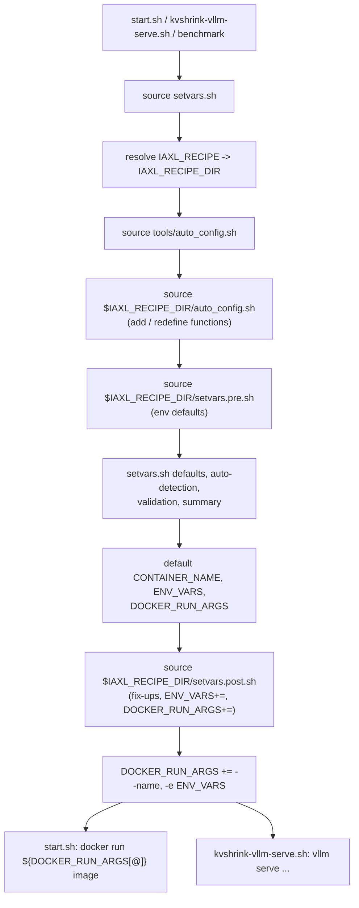

# Recipes Design

## Purpose

Running KVShrink in a new scenario used to mean editing four files that everyone shares: `setvars.sh`, `start.sh`, `tools/auto_config.sh` and `examples/kvshrink-vllm-serve.sh`. Scenarios differ in many ways:

- **GPU or device**: a different GPU generation or vendor, XPU, or CPU-only inference, each with its own base image, runtime flags and build `DEVICE`.
- **Model**: model size and architecture drive `TP_SIZE`, `--max-model-len`, block size, KV cache budgets and the async KV load settings (`KVSHRINK_VLLM_KV_ASYNC_LOAD_*`, whose layer counts depend on the model's layer count and per-layer load time).
- **Xeon SKU and accelerators**: core count and NUMA layout, QAT versus IAA versus CPU compression, DSA availability, device-to-rank assignment and the in-tree versus out-of-tree QAT driver.
- **Deployment role**: an inference node, a storage-only daemon node, or a client of a remote pool, with different container names, mounts and network settings.

Those edits are hard to keep apart from the defaults, easy to lose on update, and impossible to switch between.

A **recipe** moves the scenario-specific part into its own directory under `examples/recipes/<name>/` and selects it with one variable, `IAXL_RECIPE`. The shared scripts stay generic and grow a small, fixed set of hook points; a recipe fills in the hooks it needs and leaves the rest alone. [examples/recipes/vllm-cpu](../../examples/recipes/vllm-cpu/README.md) is a fully commented recipe for the [vLLM CPU inference guide](../usage/vllm-cpu-inference.en.md) and is the starting point for new ones.

Design goals:

- **No change to the default behaviour.** With `IAXL_RECIPE` unset, every script runs exactly as before.
- **Command line wins.** A variable set in the environment before `./start.sh` beats the recipe, and the recipe beats the defaults in `setvars.sh`.
- **One mechanism for host and container.** `IAXL_RECIPE` is forwarded into the container, so `kvshrink-vllm-serve.sh` and the benchmarks apply the same recipe there.
- **Hooks, not copies.** A recipe never replaces a shared script wholesale; it supplies fragments that the shared scripts source at defined points.

## Layout

```text
examples/recipes/<name>/
├── auto_config.sh    # optional: add or redefine shell functions
├── setvars.pre.sh    # optional: environment defaults
├── setvars.post.sh   # optional: fix-ups, ENV_VARS, DOCKER_RUN_ARGS
└── README.md         # recommended: what the scenario is and what the hooks assume
```

`IAXL_RECIPE` is either a name under `examples/recipes/` or a directory path. `setvars.sh` resolves it to the absolute `IAXL_RECIPE_DIR`, exports both, and prints `Recipe: <dir>`. An unknown name is an error, so a typo cannot silently run with defaults.

## Load order



Each hook is sourced into the caller's shell, so plain variable assignments, `export`, bash arrays and function definitions all take effect directly. A hook whose last command fails (or that executes `return 1`) aborts `setvars.sh` and whatever sourced it.

## Hooks

### `auto_config.sh`: functions

`tools/auto_config.sh` is a library of detection and sizing functions (`cpu_auto_detect`, `qat_auto_detect`, `dsa_auto_detect`, `ddr_pool_total_size_gb`, `omp_thread_count`, ...). Its last step sources the recipe's `auto_config.sh`. Because bash keeps the most recent definition of a function, a recipe can:

- **add** helpers for its other hooks, e.g. the example's `rank_cpu_split`;
- **redefine** any library function with the same name, arguments and output format, e.g. the example's `cpu_auto_detect` that skips the GPU probe. `setvars.sh` calls the redefined function wherever it used the original and still validates the output (`rank_cpu_counts`, `validate_omp_config`), so a bad override fails loudly;
- **wrap** a function by saving it under another name first: `eval "orig_$(declare -f cpu_auto_detect)"`.

The hook runs before any value is computed, so it must define functions only and not depend on `NUM_WORKERS` or other derived variables.

### `setvars.pre.sh`: environment defaults

Sourced before `setvars.sh` applies its own defaults, with all functions already available. Every setting in `setvars.sh` has the form `export VAR=${VAR:-default}`, so a recipe that exports `VAR` here changes the default without touching the precedence: environment > recipe > `setvars.sh`. The hook must follow the same `${VAR:-...}` convention for the command line to keep winning.

Typical content: `DEVICE`, docker images, `IAXL_LD_PRELOAD`, `IAXL_QATLIB`, `CONTAINER_NAME`, `MODEL`, `TP_SIZE`, feature switches, hard-coded `VLLM_CPU_OMP_THREADS_BIND` / `KVSHRINK_QAT_DEVICES` lists for fixed hardware, and the `kvshrink-vllm-serve.sh` parameters listed below. The hook may also call detection functions itself when it needs a value that `setvars.sh` would otherwise derive differently; the example does this to split each rank's CPUs between vLLM and IAXL.

### `setvars.post.sh`: fix-ups and docker

Sourced after `setvars.sh` has computed, validated and printed everything and has built the default docker settings. Three things live here:

| Variable | Default | Recipe use |
| --- | --- | --- |
| `CONTAINER_NAME` | `iaxl.vllm` | `docker --name`; also settable in `setvars.pre.sh` because the default is `${CONTAINER_NAME:-iaxl.vllm}` |
| `ENV_VARS` | proxy settings, `HOST_IP`, `MODEL`, `TP_SIZE`, `DEVICE`, `IAXL_QATLIB*`, `IAXL_VERSION`, `IAXL_LD_PRELOAD`, `IAXL_RECIPE` | Names whose host values start.sh forwards with `-e`; append the ones a user may set on the host command line and expects inside the container |
| `DOCKER_RUN_ARGS` | `--rm --privileged --pid host --net host -it -v /dev:/dev --entrypoint ""`, device flags for `DEVICE`, `HF_HOME`, `_data`, `/run/qat`, `MODEL` and repository mounts | Every `docker run` flag; append `--shm-size`, extra `-v`, `--cpuset-*`, or rebuild the array to drop a default |

`setvars.sh` appends `--name "$CONTAINER_NAME"` and `-e VAR=value` for each `ENV_VARS` entry *after* the hook, so edits to all three take effect, and `start.sh` passes nothing but `DOCKER_RUN_ARGS`, the image and the entry command to `docker run`.

Derived values (`IAXL_DDR_POOL_SIZE_GB`, `IAXL_OMP_THREAD_NUM`, device lists) are final after `setvars.sh` and can be corrected here, but they were already printed; the example echoes what it changes. Overrides here bypass `validate_omp_config`, so keep them to values that `setvars.sh` does not validate or re-validate yourself.

### `kvshrink-vllm-serve.sh`: parameters

The serve script has no hook of its own and no settings in `setvars.sh`. It reads these variables, which a recipe's `setvars.pre.sh` or the environment can set:

| Variable | Default | `vllm serve` argument |
| --- | --- | --- |
| `MODEL`, `TP_SIZE`, `DP_SIZE` | from `setvars.sh` | model, `-tp`, `--data-parallel-size` (when > 1) |
| `BLOCK_SIZE` | unset | `--block-size`, only when set |
| `VLLM_SERVE_CMDLINE_ARGS` | `--trust-remote-code --max-model-len 32765 --port 8000 --no-enable-prefix-caching --gpu-memory-utilization 0.8` | all remaining options, word-split by the shell (so no spaces inside a value); setting it **replaces** the default list, so repeat the defaults you want to keep. The `vllm-cpu` recipe sets it without `--gpu-memory-utilization` |

The `--kv-transfer-config` that loads the KVShrink connector is fixed, since it is the point of the script.

## Container propagation

`IAXL_RECIPE` is part of the default `ENV_VARS`, so the container shell started by `start.sh` has it, and `kvshrink-vllm-serve.sh` or a benchmark sourcing `setvars.sh` there resolves and applies the same recipe. For this to work the recipe directory must be visible in the container at the same path: directories under `examples/recipes/` are, because the repository is bind-mounted at its host path; a recipe outside the repository must add its own `-v` mount in `setvars.post.sh`.

Because the recipe runs again inside the container, forwarding recipe defaults through `ENV_VARS` is unnecessary. `ENV_VARS` is for values a user overrides on the host command line. An unset name is forwarded as an empty string, which `${VAR:-default}` treats as unset, so forwarding an optional variable is harmless.

## Writing a recipe

1. Copy `examples/recipes/vllm-cpu` to `examples/recipes/<name>`, keep the hooks you need, and rewrite the README for the scenario.
2. Put plain defaults in `setvars.pre.sh` using `${VAR:-value}`; put anything that needs computed values in `setvars.post.sh`.
3. Redefine a function only when the original cannot be steered through its inputs, and keep its output contract.
4. Avoid host-only commands in the hooks; they also run in the container.
5. Dry-run with `IAXL_RECIPE=<name> bash -c 'source setvars.sh && printf "%q " "${DOCKER_RUN_ARGS[@]}"; echo'` and read the `Recipe:`, configuration and `OpenMP configuration` blocks before starting the container.
